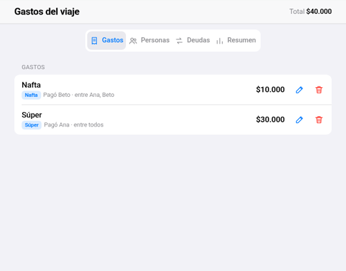
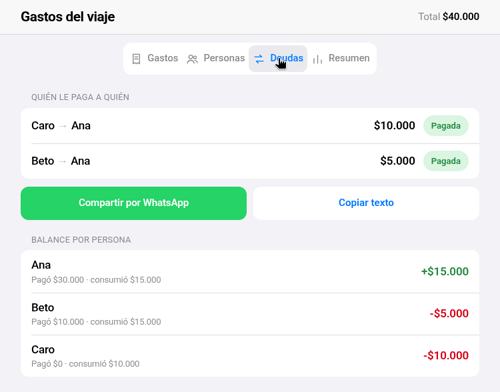

# 💸 Gastos del viaje

App web para dividir los gastos de un viaje en grupo. Cargás quién pagó qué y en qué categoría, y la app calcula quién le debe a quién con la menor cantidad de transferencias posible.

**[▶ Probala en vivo](https://serafinllensa.github.io/gastos-viaje/)**, pensada para el celular y se puede instalar como app en el iPhone.

<p>
  
  
</p>

## Qué hace
- Personas y gastos con categoría (comida, súper, nafta, alojamiento, salidas, otros). Se pueden editar y borrar.
- Calcula las deudas minimizando transferencias, y te deja marcarlas como pagadas o hacer pagos parciales.
- Muestra un resumen por categoría y lo que pagó y consumió cada persona.
- Arma el texto para compartir por WhatsApp.
- Guarda y carga el viaje en un archivo `.json`, como respaldo o para pasárselo a amigos.
- Diseño estilo iOS con modo oscuro automático. Se instala como app (PWA) y funciona sin internet.

## Cómo está hecha
- HTML, CSS y JavaScript puro, sin frameworks ni dependencias.
- Los datos se guardan en el navegador (`localStorage`), sin servidor ni cuentas.
- La lógica (`app.js`) está separada de la interfaz (`ui.js`) y tiene 30 tests automáticos.
- Un service worker permite usarla sin conexión.

```bash
node tests.js   # corre los tests
```

## Cómo se hizo
La desarrollé coordinando un equipo de agentes de IA, cada uno con su rol (interfaz, lógica y datos, QA), y yo revisé, decidí y probé en un iPhone real.
